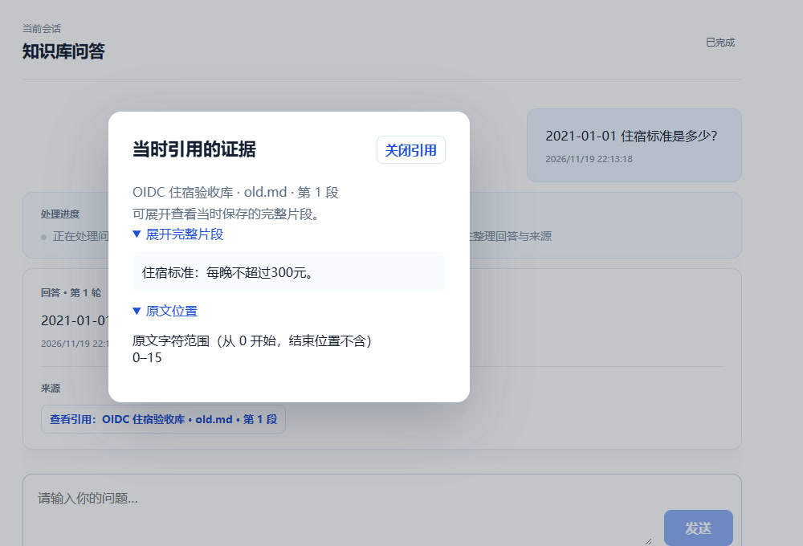
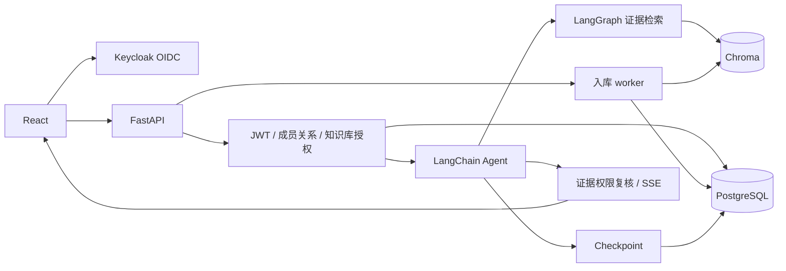

# Agent RAG Showcase

面向多租户企业文档的知识库问答 Agent。用户可以确认入库资料、对当前可读的知识库提问，并打开引用核对原文。通用问答、多轮追问与会话历史在同一界面提供。

本仓库提供架构说明、合成资料、真实运行截图与验收摘要。业务源码与完整运行环境的公开范围见[公开清单](docs/public-scope.md)。

## 核心功能

- **文档入库与历史查询**。上传后先解析和预览，确认后由后台 worker 写入索引。制度资料按生效日期和正文修订范围检索，可追溯当时引用的片段。
- **多租户访问控制**。Keycloak 通过 OIDC 登录，API 验证 JWT 并读取当前成员关系。用户所在组和知识库授权决定可读范围，检索在召回前限制租户及可读库，首段答案发出前再复核证据权限。
- **按证据回答**。可读知识库的名称、描述或标签命中时先检索。LangGraph 执行改写、召回、重排和证据筛选。当前轮缺少支持原题的依据时，回答「未找到可用依据」并返回零引用。依赖故障单独报告。
- **会话与服务**。FastAPI/SSE 推送阶段、答案与引用。PostgreSQL 分开保存业务历史和 LangGraph Checkpoint，每个会话同时只处理一轮。另提供 Streamable HTTP MCP 检索入口与逐请求日志。
- **本地交付**。Docker Compose 编排 React、FastAPI、PostgreSQL、Keycloak 与入库 worker，通过健康检查管理启动顺序，并用独立任务初始化 Chroma 索引。

## 真实运行效果

以下截图来自 2026-11-19 的 Docker 试用栈，使用真实 Keycloak、模型、PostgreSQL 与 Chroma。测试数据为合成资料，展示图裁去导航和账号栏。[场景与验收记录](docs/demo.md)

### 按日期查询并打开引用

询问「2021-01-01 住宿标准是多少？」得到每晚不超过 300 元，并打开当时有效的 `old.md` 原文。会话把实时回答更新为持久化历史后，引用弹窗仍保持打开。



### 两个租户问同一个问题

两个合成租户都问「蓝鲸编号 ZX-8821 出现在哪里？」。甲租户只有资料索引，返回「未找到可用依据」且无引用。乙租户有观测记录，回答「2024 年、北纬 30 度」，并引用本租户文档。[甲租户截图](docs/images/05-tenant-a-refusal.jpg) · [乙租户截图](docs/images/06-tenant-b-answer.jpg)

## 架构与验证



- **真实浏览器**。最终 OIDC 验收 12 项通过，覆盖登录、退出、令牌过期、目录路由、历史引用与双租户问答隔离。[验收明细](docs/evaluation.md)
- **低并发试跑**。隔离栈中 13 条正常问答完成，两份合成文档成功入库。同会话的重叠请求按预期返回 `409 conversation_busy`。样本只覆盖两个租户各一个在途问答及一份文件同时入库。[试跑范围](docs/evaluation.md)
- **问答开发集**。30 题端到端基线为 20/30，固定拒答话术后的三次运行分别为 22/30、24/30、25/30。题集与判分属于开发验证，详见[评测口径](docs/evaluation.md)第 4 节。

[详细架构与权限边界](docs/architecture.md) · [个人贡献与 AI 协作](docs/contributions.md) · [截图哈希与来源摘要](docs/evidence.json)

## 复核展示材料

```bash
python tools/check_showcase.py
```

脚本检查公开文件白名单、相对链接、配置空值、文本敏感模式及截图 SHA-256。应用验收使用原项目的隔离试用环境，记录见[演示与复现范围](docs/demo.md)。本地试用已覆盖预配置账号登录。自助注册、邀请、公开 CI 与生产容量仍未验收。
