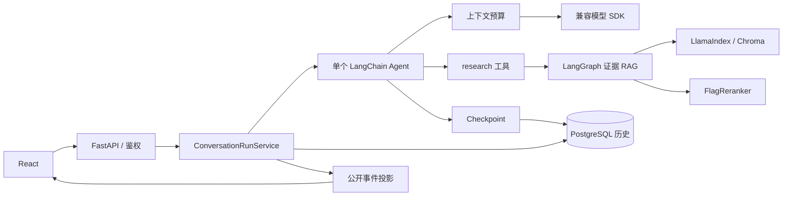
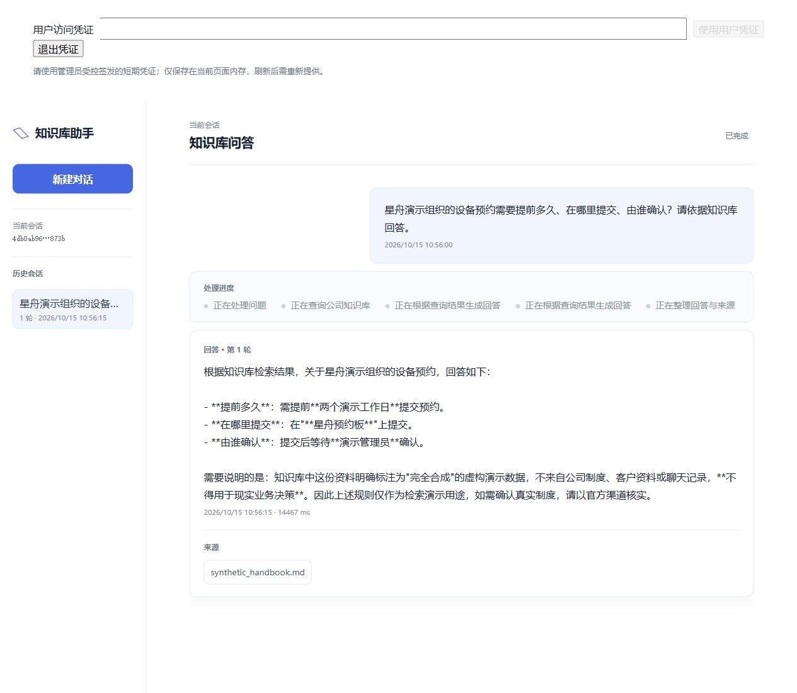
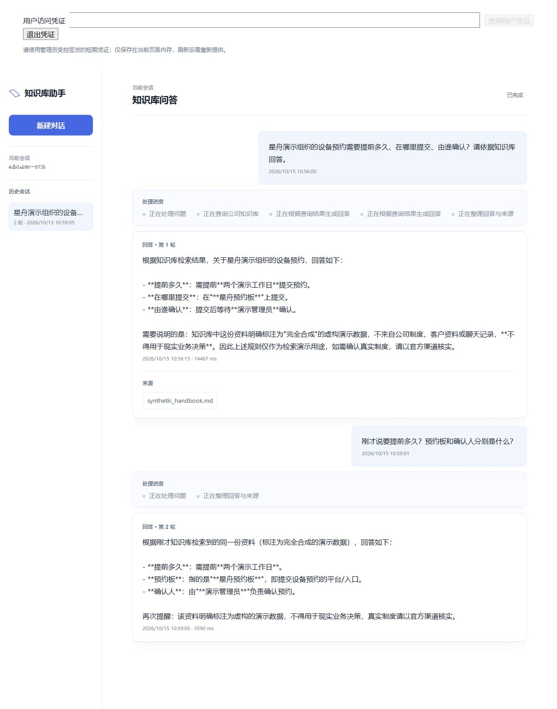
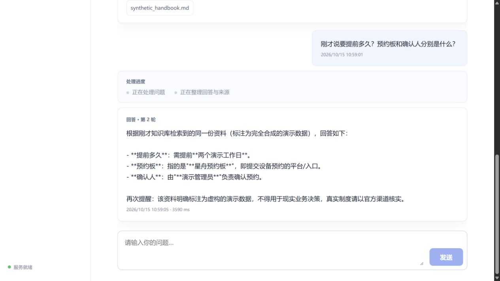

# Agent RAG Showcase

一个面向内部文档问答场景的通用对话与知识库 Agent 项目，重点展示 **工具调用、证据检索、多轮会话和服务工程边界**。

> **公开范围：展示材料版，不是完整源码发布版。** 本仓库提供架构、实现状态、真实运行截图、合成数据及评测说明；业务后端、前端和测试源码的公开权尚未完成确认，暂不上传。因此不能 clone 后直接启动完整应用，也不声称第三方可以复现全部测试。源码范围见 [公开清单](docs/public-scope.md)。

## 30 秒看懂

- 普通问题由单个 LangChain Agent 回答；知识库问题通过 `research(question)` 调用固定的 LangGraph 证据工作流。
- RAG：查询改写 → Chroma 召回 → FlagReranker 重排 → 严格阈值过滤 → 返回文档原文与来源，再由主 Agent 回答。
- FastAPI/SSE 与 React 显示处理阶段、答案、引用及多轮历史；新 Agent 不逐 Token 公开生成内容。
- PostgreSQL 业务历史与框架 Checkpoint 分离；短事务、心跳和陈旧状态清理管理活动轮次。
- JWT 可信用户、当前租户成员校验、完整会话 scope、近似 Token 预算和 HTTP 超时/有限重试已有实现及对应验证记录。

**阶段：本地可运行的个人开发/演示项目。** 没有生产上线、高并发、真实企业客户或业务收益证据；不是多 Agent 平台、NL2SQL 或个人认知 IP 系统。

## 架构



完整流程、实现定位与功能分类：[architecture.md](docs/architecture.md)。

## 真实运行效果

以下截图采集于 **2026-10-15 的同一版本**：远端真实模型 + 本地 Embedding/Reranker/Chroma + 新建 PostgreSQL 演示库 + 原 React/FastAPI 应用。未使用 Mock 响应、静态页面、设计稿或图片合成。资料、用户和问答均为明确合成数据，凭据未进入截图。

### 1. 知识库问题与来源

输入：“星舟演示组织的设备预约需要提前多久、在哪里提交、由谁确认？请依据知识库回答。”

输出：“两个演示工作日、星舟预约板、演示管理员”，并引用 `synthetic_handbook.md`；模型同时说明资料完全虚构、不用于现实决策。体现 Agent → 工具 → 证据 RAG → 回答与引用 → 历史持久化的闭环。



### 2. 同会话连续追问

输入：“刚才说要提前多久？预约板和确认人分别是什么？”

输出沿用上轮语境的三个要点，两轮历史均保留。Checkpoint 消息实际参与后续生成，不只是界面排列历史文本。



### 3. 刷新后恢复历史

操作：切到空会话 → 刷新 → 页面内存凭据清空 → 重新认证。原会话的两轮内容从服务端恢复；HTTP 历史与真实 SQL 记录一致。截图为恢复后的末轮视口。



[演示步骤、实际结果与启动条件](docs/demo.md) · [评测与测试边界](docs/evaluation.md) · [脱敏证据摘要](docs/evidence.json)

## 技术取舍

| 选择 | 解决的问题 | 当前限制 |
|---|---|---|
| 固定证据 RAG 作为工具 | 将可测试的检索过程与模型选择/最终生成分开 | 非空高分证据不等于答案被证实；新链路无强制 answerability 门禁 |
| 短事务后执行模型 | 避免持有数据库行锁等待长模型请求 | 需要心跳与陈旧状态补偿，不是任意任务自动重跑 |
| 每次主模型调用前预算检查 | 工具回填后再次计算输入并动态设置输出上限 | 近似估算；内部改写和旧图不受同一中间件保护，无自动摘要 |
| 公开 SSE 白名单 | 不向界面透出全部框架状态、原始工具正文或内部异常 | 新 Agent 公开阶段/最终结果，而非逐 Token 输出 |
| 每请求读取当前成员源 | 同 Token、同应用实例撤销成员后下一请求拒绝 | 单机文件源；尚无文档级 ACL 或完整登录平台 |

## 个人贡献与 AI 辅助

开发记录支持项目作者参与会话 scope、短事务、证据工具边界、Agent 装配、阈值/预算取舍及部分实现与真实测试复现。前端、运行服务、鉴权、心跳、SDK 策略和测试中存在 AI 辅助/参考实现，不能据此写成全部独立编码。

本次展示整理、隔离真实运行及截图采集也由 AI 辅助执行。具体个人职责、时间投入和参考来源仍应由作者补齐；不把个人项目冒充任职公司生产业绩。见 [contributions.md](docs/contributions.md)。

## 如何阅读与复核

本仓库不含应用业务源码，所以没有可用的 `npm run dev` 或完整服务安装入口。它包含的 Python 工具仅检查公开材料：

```bash
git clone https://github.com/JacoryOu/agent-rag-showcase.git
cd agent-rag-showcase
python tools/check_showcase.py
```

Python 工具仅使用标准库；可检查文件白名单、配置空值、敏感模式、本地链接和截图 SHA-256，**不会运行模型或证明应用功能正确**。完整本地应用还需要业务源码、Python/Node 依赖、模型凭据、授权权重、新演示库与索引，详见 [公开范围](docs/public-scope.md) 和 [组件来源](NOTICE.md)。

## 已知限制

本轮真实演示只有 1 篇合成文档、2 个问题；不是大样本答案质量或生产安全验收。没有文档 ACL、自动摘要、通用请求幂等、任意任务重启自动续跑、多 Agent 协作、真实联网检索或微调训练成果。最终落库失败可能在 final 后追加历史错误，不能称为强原子提交。历史候选筛选指标也不能当作答案准确率。
