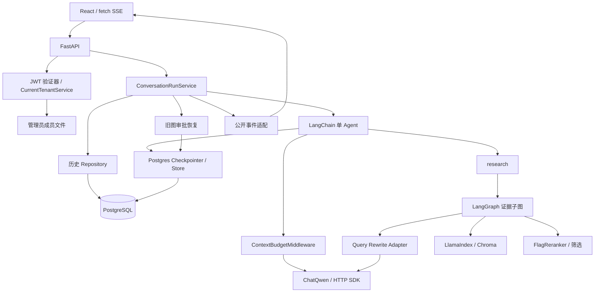

# 实际架构、功能状态与实现定位

核对日期：2026-10-15。以下模块/符号是**原本地实现定位，不代表源码已在本仓库公开**。已检查实际装配、路由、图、仓库、预算、SDK、前端、依赖与已有运行记录；不单独以README或规划证明功能。

## 请求与数据流

1. 前端提交问题、公开thread_id和Bearer。服务资格与用户身份分开；服务端JWT确定可信用户，当前成员源确定有效租户，不接受自报tenant/user覆盖。
2. 路由形成完整tenant/user/thread scope；仓库先在短事务中创建running，事务提交后Service才执行图/模型。
3. 主Agent每次模型请求前计算近似预算；模型选择直接回答或调用research。一次证据子图按改写→召回→重排→严格score大于阈值过滤→来源/证据状态返回，不生成最终答案。
4. 工具返回过滤后的正文和来源，再由主Agent组织回答；无命中是has_no_result，工具异常转failed及安全提示。有证据不自动证明答案可支持。
5. SSE只投影公开字段；Service持久化阶段与终态、答案、来源、耗时并释放活动状态。模型上下文来自同scope Checkpoint消息，历史表主要用于展示/查询。
6. Command审批恢复沿用旧图；不能把旧图judge/HITL算作新Agent的可回答性门禁。旧图恢复、新Agent使用不同checkpoint命名空间。

## 功能分类

| 功能 | 完成状态 | 实现定位与验证范围 |
|---|---|---|
| 普通回答/模型工具选择 | 已实现并验证 | backends.py:ProductionResources.start/create_agent；graph.py:build_knowledge_base_tool；历史真实模型和确定性模型测试 |
| Markdown、分块、向量索引 | 已实现并验证 | rag.py、rag_bootstrap.py:build_initial_rag_index；本次真实合成1文档/2分块 |
| 改写、召回、重排、阈值、来源 | 已实现并验证 | graph.py:build_evidence_rag_subgraph，reranker.py；本次真实模型/检索及图、工具离线测试 |
| 无命中/查询失败合同 | 已实现并验证 | graph.py:research；has_no_result与failed区分，离线失败用例；本次截图未做故障注入 |
| 多轮、历史、刷新恢复 | 已实现并验证 | conversation_run_service.py、conversation_history_postgres.py、sse.py、React App；本次2轮与真实HTTP/SQL/Checkpoint读回 |
| 完整会话scope过滤 | 已实现并验证 | dependencies.py:scoped_thread_id；Repository完整WHERE；受控跨user/tenant测试，不能声称文档ACL |
| JWT与成员撤销 | 已实现并验证 | auth.py:JwtIdentityVerifier；tenant_membership.py；同Token/应用下撤销后下次请求拒绝，受控HTTP测试 |
| 主Agent预算 | 已实现并验证 | context_budget.py:ensure_context_budget与middleware；逐调用估算、最小预留及动态输出cap，离线与历史usage样本 |
| HTTP超时/有限重试 | 已实现并验证 | model_provider.py、model_errors.py；同步/异步客户端5秒连接、60秒其他阶段、额外重试1次，受控本地socket验证 |
| 心跳、陈旧running清理 | 已实现并验证 | Service独立心跳；Repository:reconcile_stale_running；相关测试/历史真实PG记录，awaiting_approval保留 |
| Checkpoint与旧审批续接 | 已实现并验证 | PostgresSaver装配、Command旧图；历史真实PG续接记录；本次只验证消息持久化及读取，不验证重启续跑 |
| 新图强制答案支持门禁 | 开发中/已知问题 | 有高分候选即可has_evidence，提示约束不能代替强校验；尚无独立答案质量测试集 |
| 最终生成与落库强原子成功 | 开发中/已知问题 | 最终落库失败可能先final再history error，不承诺全局强原子 |
| 已声明的local模型模式 | 开发中/已知问题 | Settings枚举存在，但当前模型工厂只实现dashscope分支，不能视为已支持多厂商切换 |
| 新环境/平台可运行性 | 已实现但未验证 | 当前代码有本地启动入口；干净Python安装、Linux/GPU/容器、其他浏览器未验；本仓库没有完整源码供外部复现 |
| 文档ACL、登录注册/刷新、分布式IAM | 规划/未实现 | 当前是受控JWT主体+单机当前成员文件，不是完整用户平台 |
| 自动摘要/历史裁剪、精确tokenizer | 规划/未实现 | 超限拒绝，不删除历史；内部改写和旧图不经过主Agent预算中间件 |
| 有界重检索/通用请求幂等/自动重跑 | 规划/未实现 | 证据图内部一次改写检索；主Agent可再调工具，但没有明确检索循环预算或exactly-once |
| 远程部署、并发容量、业务收益 | 规划/未实现或无证据 | 原部署文件为占位，无生产/负载/客户验收证明 |

## 关键取舍

- **单Agent + 固定工具图**：模型负责选择和生成，固定RAG提供可测试证据流程；不是多Agent协作。
- **图与依赖分离**：图依赖AgentDependencies业务合同；底层检索/SDK/重排由适配层提供。保留同步RAG节点的executor调度，不能无证据称其阻塞事件循环或全部应改async。
- **短事务与独立心跳**：不持数据库锁等待模型；用事务终态更新与状态补偿管理残留活动轮次，不自动重跑模型。
- **三个状态概念分开**：聊天历史供查询；Checkpoint保存框架消息/中断；陈旧轮次清理是failed+释放，并非真正恢复图。Store已装配不代表画像/长期记忆自动参与生成。
- **预算保护**：每次主Agent请求估算系统消息、历史、工具定义及工具结果，cap取剩余安全空间和模型最大输出的较小值；不足最低预留拒绝。不是固定生成长度，也不保证精确计数。
- **超时与公开边界**：HTTP阶段超时不是Agent整轮墙钟截止；部分事件后超时不应重播整轮或伪造成功。新Agent公开stage/final/error，旧图保留审批兼容。

个人认知IP、聊天导入/画像访谈/记忆更新、内容采集/大纲/草稿/反馈、多平台输出与Skill沙盒没有集成到此主项目。LoRA/QLoRA仅了解原理和基本流程，无训练/评测成果。
